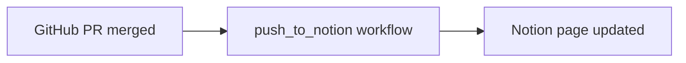

## 🎯 Overview

High-level description of the technical implementation, architecture decisions, and key components.

## 🔧 Technical Details

Detailed explanation of the implementation, including APIs, data models, algorithms, and system interactions.

## ⚡ Performance Considerations

Analysis of performance implications, scalability concerns, and optimization strategies.

## 🧪 Testing Strategy

Outline of unit tests, integration tests, and testing approaches to ensure reliability.

## 📋 Dependencies & Requirements

List of technical dependencies, system requirements, and any external services needed.